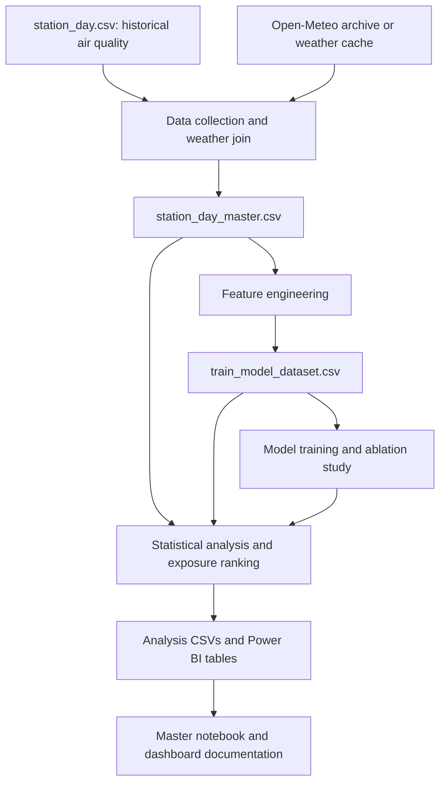

# AirWatch

**Air-quality risk forecasting and population-exposure analysis for Indian monitoring stations.**

AirWatch is an academic data science project that combines historical air-quality readings, weather data, and regional context to estimate whether a station's future AQI will reach **201 or higher**. It also explores seasonal pollution patterns and ranks city clusters by a population-weighted exposure index.

The repository includes datasets, feature-engineering and training scripts, executed notebooks, analysis exports, a dashboard preview, and presentation material.

## What the project does

- Enriches daily station observations with temperature, humidity, wind, rainfall, and pressure from Open-Meteo.
- Builds pollutant lags, rolling statistics, weather indicators, and calendar features.
- Compares a persistence baseline with Logistic Regression, Random Forest, LightGBM, and XGBoost.
- Evaluates three feature groups to measure the contribution of weather and regional context.
- Runs seasonality tests, pollutant-weather correlations, and station clustering.
- Produces population-weighted exposure rankings and CSV tables for a five-page Power BI dashboard.

## Prediction task

The primary binary target is:

```text
Target_PoorOrWorse_t1 = 1 when the next station observation has AQI >= 201
                       0 otherwise
```

The feature pipeline also creates a second-observation target for a two-step forecast comparison. The main training script evaluates the first target.

The intended horizons are one and two days. Because targets use shifts within each station's observations, missing calendar dates can make an observation step longer than one day. The output represents an AQI threshold event; official GRAP declarations and enforcement decisions are outside the model.

## Data and workflow

The supplied station dataset contains 108,035 daily records across 110 stations. The collection script maps station-ID prefixes to 21 representative city clusters and joins weather by state code and date, using a local cache when available.



| Input or feature | Implementation |
| --- | --- |
| Air quality | Included `station_day.csv`, described in the project report as CPCB station data; includes AQI and pollutant readings. |
| Weather | Open-Meteo historical daily weather, cached in `data/weather_cache.csv`. |
| Location and population | Fixed city coordinates and density values in `CITY_METADATA` in `scripts/data_collection.py`. The script does not download WorldPop rasters. |
| Satellite context | A simulated proxy derived from weekly ground NO2 averages, with simulated cloud gaps. The repository pipeline does not ingest Sentinel-5P measurements. |

## Repository guide

| Path | Purpose |
| --- | --- |
| [`AirWatch_Comprehensive_Master.ipynb`](AirWatch_Comprehensive_Master.ipynb) | Main notebook presenting the analysis, figures, and results. |
| [Data collection notebook](AirWatch_Data_Collection%20%281%29.ipynb) | Earlier data collection and exploration work. |
| `station_day.csv` | Base station observations. |
| `station_day_master.csv` | Air-quality observations joined with weather and regional metadata. |
| `train_model_dataset.csv` | Engineered predictors and forecast targets. |
| [`scripts/`](scripts/) | Collection, feature engineering, training, analysis, and notebook utilities. |
| [`data/`](data/) | Weather cache, model metrics, feature importance, clustering, and exposure outputs. |
| [`data/powerbi/`](data/powerbi/) | Five dashboard-ready CSV exports. |
| [`Initial_work/`](Initial_work/) | Earlier notebook and dataset snapshots. |
| [`powerbi_dashboard_preview.html`](powerbi_dashboard_preview.html) | Browser-based dashboard design preview. |
| [`PowerBI_Dashboard_Specification.md`](PowerBI_Dashboard_Specification.md) | Dashboard layout, measures, and implementation guidance. |
| [`Final_Project_Report.md`](Final_Project_Report.md) | Detailed academic report. |
| [`LIMITATIONS_SHEET.md`](LIMITATIONS_SHEET.md) | Additional discussion of scope and limitations. |
| [`Presentation_Slide_Deck.md`](Presentation_Slide_Deck.md) | Presentation content. |

## Setup

Use a Python environment with the following packages. Python 3.10 or newer is a suggested starting point; dependency versions are not pinned in this repository.

```bash
git clone https://github.com/Kabira2006/AirWatch.git
cd AirWatch
python -m venv .venv
```

Activate the environment on Windows PowerShell:

```powershell
.\.venv\Scripts\Activate.ps1
```

On macOS or Linux:

```bash
source .venv/bin/activate
```

Install the packages used by the scripts and notebooks:

```bash
python -m pip install pandas numpy requests scipy matplotlib seaborn scikit-learn xgboost lightgbm nbformat nbclient jupyterlab ipykernel
```

## Explore the included results

Launch JupyterLab from the repository root and open `AirWatch_Comprehensive_Master.ipynb`:

```bash
python -m jupyterlab
```

The included notebook and CSV exports let you inspect the existing analysis without retraining every model. Open `powerbi_dashboard_preview.html` in a browser to view the dashboard concept. Its fonts and Chart.js require internet access, and its slider uses approximate simulation formulas rather than live model inference.

For Power BI Desktop, import the five CSV files in `data/powerbi/` and follow the dashboard specification. The repository provides the data and design instructions; it does not include a finished `.pbix` file.

## Reproduce the pipeline

Run these commands **from the repository root**, in order:

```bash
python scripts/data_collection.py
python scripts/feature_engineering.py
python scripts/train_models.py
python scripts/statistical_analysis_and_export.py
```

1. **Collect and join:** reads `station_day.csv`, loads cached weather or requests it from Open-Meteo, and writes `station_day_master.csv`.
2. **Engineer features:** creates station-specific lagged predictors, rolling summaries, simulated satellite context, calendar variables, and targets; writes `train_model_dataset.csv`.
3. **Train models:** compares the baseline and four classifiers across three feature groups; writes `data/ablation_results.csv` and `data/feature_importance.csv`.
4. **Analyze and export:** computes statistical summaries, clustering, exposure rankings, decision-threshold comparisons, forecast-horizon comparisons, and Power BI tables.

These commands overwrite their generated CSV outputs. Weather requests require internet access when the cache is absent; the base station CSV is supplied locally rather than downloaded by the collection script.

To execute the existing master notebook programmatically:

```bash
python scripts/execute_master_notebook.py
```

This saves execution outputs back into the notebook, including partial outputs if execution fails. The separate `build_master_notebook.py` utility regenerates the notebook structure and should only be run when you intend to replace the existing notebook content.

## Model evaluation and included results

Training uses records dated **before January 1, 2020**; testing uses records **on or after January 1, 2020**. Three feature groups are compared: ground readings alone, ground readings with weather, and those features with population, simulated satellite, and calendar context.

Selected results from [`data/ablation_results.csv`](data/ablation_results.csv), rounded to four decimal places:

| Model | Features | Accuracy | F1 | ROC-AUC | Average precision (CSV: PR-AUC) |
| --- | --- | ---: | ---: | ---: | ---: |
| Persistence | Today's AQI threshold | 0.9231 | 0.7929 | 0.8757 | 0.6654 |
| Logistic Regression | Ground only | 0.9370 | 0.8232 | 0.9747 | 0.9130 |
| Random Forest | Ground + weather | 0.9406 | 0.8382 | 0.9757 | 0.9170 |
| LightGBM | Ground only | 0.9403 | 0.8372 | 0.9775 | 0.9227 |
| LightGBM | Ground + weather | 0.9391 | 0.8344 | 0.9776 | 0.9232 |
| XGBoost | Ground + weather | 0.9381 | 0.8319 | 0.9765 | 0.9204 |

LightGBM with weather has the highest ROC-AUC and average precision in the included export, while Random Forest with weather has the highest accuracy and F1. Weather's improvement over the strongest ground-only model is small; adding the full context feature group does not improve every metric. These are saved historical experiment results, not a fresh benchmark run.

## Exposure prioritization

The analysis groups stations by mapped city cluster and computes:

```text
Exposure Risk Index = percentage of observations with AQI >= 201
                      * (population density per km² / 1000)
```

This index combines exceedance frequency with population density to support comparisons between clusters. Although some export names use “district,” their geographic grouping follows the script's city mappings. The index is a comparative project score, not a measured count of exposed people or a clinical health-risk estimate.

## Interpretation and limitations

- City-level coordinates and fixed densities simplify spatial differences between monitoring stations. Population values and source provenance should be verified before extending the analysis.
- The satellite proxy is synthetic. Calibration against this ground-derived proxy does not establish agreement with independently observed satellite data.
- Weekly proxy means may include observations later than a prediction timestamp, and fallback medians are computed before the chronological split. A stricter forecasting evaluation should use past-only aggregates and fit imputation on training data alone.
- The target is shifted by observation rather than by a verified calendar-day join. Split-boundary labels also need purging for a strictly isolated holdout.
- The collection script names its wind field `WindSpeed_ms` but does not explicitly request the API's wind-speed unit. Verify cached and downloaded units before interpreting physical wind thresholds.
- Historical evaluation covers the supplied 2015–2020 period and does not establish performance on current conditions or unseen stations.
- The repository is a batch analysis project. The training script exports metrics and feature importance, rather than a persisted model or a deployed prediction API.

Some narrative claims in the longer report are broader than the implementation. Use the scripts and exported tables to assess what is implemented and treat the assumptions above as part of interpreting the results.
